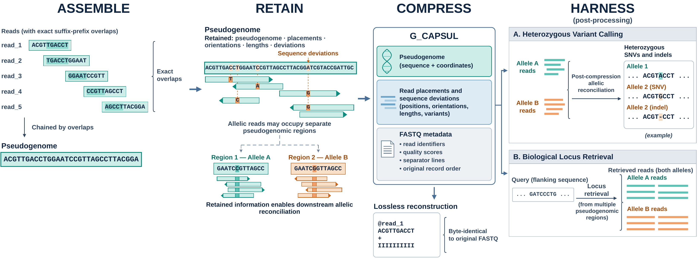
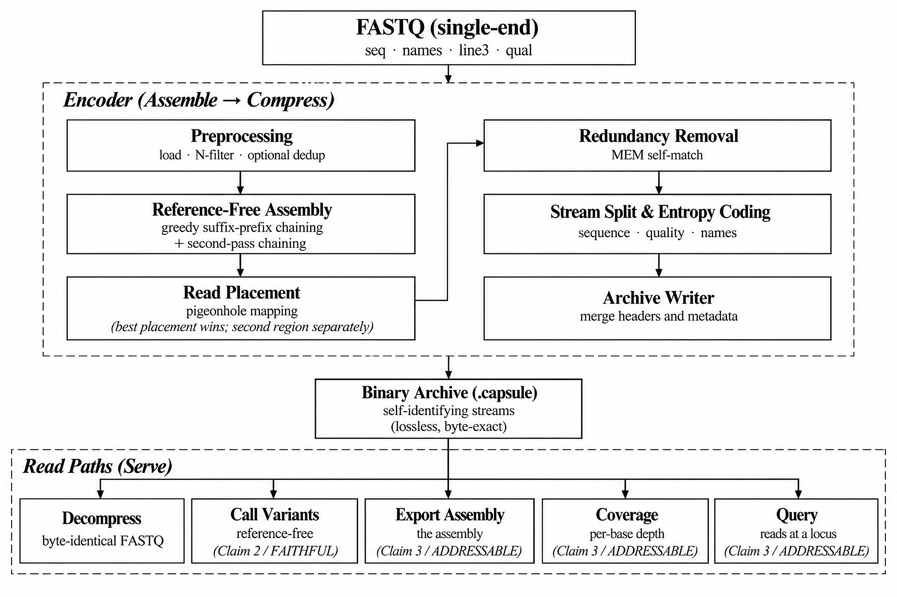

# G_CAPSUL

**Lossless, reference-free FASTQ compression with a retained pseudogenome for downstream analysis**

[](https://github.com/thackshanaramana0-spec/g_capsul/actions/workflows/ci.yml)
[](LICENSE)
[](#installation)
[](https://en.cppreference.com/w/cpp/17)

<p align="center">
  <a href="Figures/graphical_abstract.pdf"></a>
</p>
<p align="center"><sub>Graphical abstract. The ARCH principle: Assemble, Retain, Compress and Harness. <a href="Figures/graphical_abstract.pdf">Vector version (PDF)</a>.</sub></p>

---

## Contents

- [Overview](#overview)
- [Features](#features)
- [Installation](#installation)
- [Quick Start](#quick-start)
- [Usage](#usage)
  - [Try it on your own FASTQ](#try-it-on-your-own-fastq)
- [Input requirements](#input-requirements)
- [Configuration](#configuration)
- [Benchmark results and reproducibility](#benchmark-results-and-reproducibility)
- [Repository structure](#repository-structure)
- [Limitations](#limitations)
- [Citation](#citation)
- [License](#license)

---

## Overview

G_CAPSUL is a lossless FASTQ compressor that keeps the structure found during compression
available after the archive is written. It follows the **ARCH design principle: Assemble,
Retain, Compress, Harness**. Reads are assembled into a reference-free pseudogenome, and the
read placements, orientations, lengths and local sequence deviations are retained in the
archive alongside it. The same retained representation is then used for exact FASTQ
reconstruction, reference-free variant calling, sequence export, per-base coverage and locus
retrieval, without returning to the original FASTQ and without a reference genome.

Reads that support different alleles of a heterozygous site can be placed in separate
pseudogenomic regions during compression. G_CAPSUL reconciles those regions at analysis time,
so variant calling and locus retrieval do not alter the stored archive.

The scientific motivation, evaluation and discussion are in the accompanying manuscript and
its supplementary material. This repository holds the implementation, the scripts that
produce every reported number, and the result files.



## Features

- **Lossless FASTQ archive** holding sequence, read order, read names, quality scores and the
  line-3 mode, for the input described in [Input requirements](#input-requirements).
  G_CAPSUL supports byte-identical FASTQ reconstruction for supported input.
- **Reference-free variant calling from the archive** for heterozygous SNVs, indels and
  multi-allelic sites, including a ploidy option, without the original FASTQ or a reference.
- **Archive-native operations**: `export` (pseudogenome as FASTA), `coverage` (per-base
  depth) and `query` (reads at a locus), each reading the same archive.
- **Optional post-compression index** (`index`, an FM-index) for exact-match read retrieval.
- **Strict input checking**: unsupported input is refused with an error rather than converted
  or silently altered.

---

## Installation

**Requirements.** Linux (tested on Ubuntu 24.04 in CI and Ubuntu 26.04 under WSL2) or macOS with
Homebrew GCC (CI). A C++17 compiler with OpenMP (GCC, because Apple Clang lacks `-fopenmp`),
`liblzma` headers and `python3`. On Ubuntu or Debian:

```bash
sudo apt-get install build-essential cmake liblzma-dev python3
```

**CMake** (also builds the tests):

```bash
cmake -S . -B build -DCMAKE_BUILD_TYPE=Release
cmake --build build -j"$(nproc)"                 # build/best106 (encoder), build/capsule_decode
(cd build && ctest --output-on-failure)          # FM-index self-test and end-to-end test
```

**Build scripts** (equivalent, used in the Quick Start): `scripts/build_scripts/build106.sh` and
`scripts/build_scripts/build_decode.sh`. Both builds default to a portable `-march=x86-64-v2`
(`CAPS_BUILD_NATIVE=1` for the scripts or `-DCAPS_BUILD_NATIVE=ON` for CMake selects
`-march=native`). Archives written by one build decode with the other. `make` and `make test`
wrap the CMake commands.

**Docker.** Build with `docker build -t g_capsul .`, or pull the published image:

```bash
docker pull ghcr.io/thackshanaramana0-spec/g_capsul:1.2.0    # or :latest
mkdir -p outdir
docker run --rm -v "$PWD":/data ghcr.io/thackshanaramana0-spec/g_capsul:1.2.0 \
    capsule_decode /data/out.capsule /data/outdir /data/outdir/reads.fq
```

The image contains `best106` (compress) and `capsule_decode` (decompress and the `export`,
`coverage`, `query`, `call` and `index` subcommands). CI builds it and checks a round trip on
every push ([`ci.yml`](.github/workflows/ci.yml), [`publish-image.yml`](.github/workflows/publish-image.yml)).

The comparison tools used in the benchmarks (SPRING, Genozip, DiscoSNP++, Kmer2SNP with KMC,
SPAdes, bwa, samtools, mosdepth, bcftools, rtg-tools, PgRC2) are installed separately. The
commands are in [`docs/extras/SERVER_SETUP_AND_DOWNLOADS.md`](docs/extras/SERVER_SETUP_AND_DOWNLOADS.md).

---

## Quick Start

Build, then check that one FASTQ file (single-end, uncompressed) survives compression. Use the first check for a full verification, or the second for a quick one.

```bash
git clone https://github.com/thackshanaramana0-spec/g_capsul.git && cd g_capsul
scripts/build_scripts/build106.sh /tmp/best106
scripts/build_scripts/build_decode.sh /tmp/capsule_decode

# Check 1 (full): compress, decompress and compare byte for byte through the archive. Prints BYTE-IDENTICAL,
# or REFUSED with the reason if the input is unsupported.
BEST=/tmp/best106 DEC=/tmp/capsule_decode scripts/build_scripts/verify_roundtrip.sh path/to/reads.fq

# Check 2 (quick): sequence column only, not through the archive
BEST=/tmp/best106 scripts/build_scripts/verify_lossless.sh path/to/reads.fq
```

Check 2, `verify_lossless.sh`, compares the
sequence column rebuilt from the encoder's raw stream dumps, so it tests assembly, mapping and
read order but not the archive's entropy layer, names or quality.

---

## Usage

```bash
# Compress a complete FASTQ (sequence, names, quality, line 3)
CAPS_NAMES=1 CAPS_QUAL=1 INPUT=reads.fq ARCHIVE=out.capsule BEST=/tmp/best106 \
    bash scripts/build_scripts/encode_adaptive.sh

# Compress sequence and read order only (the default, not a full FASTQ)
INPUT=reads.fq ARCHIVE=out.capsule BEST=/tmp/best106 bash scripts/build_scripts/encode_adaptive.sh

# Decompress. The output directory must already exist.
mkdir -p outdir
/tmp/capsule_decode out.capsule outdir outdir/reads.fq
#   outdir/reads.fq        sequences, one per line, in the original order
#   outdir/reads.fq.names  headers without '@'  (archives written with CAPS_NAMES=1)
#   outdir/reads.fq.qual   quality lines        (archives written with CAPS_QUAL=1)

# Archive-native operations (each reads the same archive)
/tmp/capsule_decode export   out.capsule contigs.fa
/tmp/capsule_decode coverage out.capsule coverage.tsv     # region, start, end, depth
/tmp/capsule_decode query    out.capsule region.fa 0-100000
/tmp/capsule_decode index    out.capsule out.qidx         # optional index for repeated queries

# Reference-free variant calling from the archive (archive written with CAPS_CALL=1)
CAPS_CALL=1 CAPS_NAMES=1 CAPS_QUAL=1 INPUT=reads.fq ARCHIVE=out.capsule BEST=/tmp/best106 \
    bash scripts/build_scripts/encode_adaptive.sh
CAPS_CALL_INDELS=1 /tmp/capsule_decode call out.capsule calls.vcf callwork   # SNVs and indels
/tmp/capsule_decode call out.capsule calls.vcf callwork                      # faster, SNVs only

# Variant calling fused with compression (single pass, CAPS_PLOIDY=4 for a tetraploid sample)
CAPS_CALL=1 CALL_VCF=calls.vcf /tmp/best106 reads.fq 3 16 16 22 16 16 1 24 64 1
```

Calls are in the coordinates of the archive's contigs. The benchmarks lift them to genome
coordinates with `scripts/benchmark_scripts/lift_vcf.py` before scoring with `rtg vcfeval`
(see `scripts/claim3_scripts/run_fullchr20_archive_capsule.sh`).

### Try it on your own FASTQ

This compresses a FASTQ through the archive, decodes it, rebuilds the 4-line FASTQ from the
decoder output alone, and compares it with the original byte for byte, read order and line 3
included. Run from the repository root after the [Quick Start](#quick-start) builds.

```bash
IN=reads.fq                 # your single-end FASTQ (uncompressed)
W=capsul_try; mkdir -p "$W/dec"

# 1. Optional input pre-check (the encoder and scope checker refuse the same cases, see
#    Input requirements). Each count must be 0.
grep -c $'\r' "$IN"                                                    # CRLF line endings
awk 'NR%4==2 && /[^ACGTN]/ {b++} END {print b+0}' "$IN"               # bases outside upper-case ACGTN
awk 'NR%4==2 && length($0)>256 && index(substr($0,257),"N") {b++} END {print b+0}' "$IN"   # N after base 256
awk 'NR%4==1 {h=substr($0,2)} NR%4==3 {if ($0=="+") p++; else if ($0=="+"h) c++; else o++}
     END {print (o>0 || (p>0 && c>0)) ? 1 : 0}' "$IN"                 # mixed or other line 3

# 2. Compress (full FASTQ). Unsupported input stops here with an error and exit code 1 or 2.
CAPS_NAMES=1 CAPS_QUAL=1 INPUT="$IN" ARCHIVE="$W/reads.capsule" \
    BEST=/tmp/best106 bash scripts/build_scripts/encode_adaptive.sh

# 3. Decompress
/tmp/capsule_decode "$W/reads.capsule" "$W/dec" "$W/dec/reads.fq"

# 4. Rebuild the FASTQ. Line 3 is stored as a mode: a bare '+' for every read, or '+'
#    followed by the read's header. Use the first command for '+', the second for '+header'.
paste -d'\n' <(sed 's/^/@/' "$W/dec/reads.fq.names") "$W/dec/reads.fq" \
             <(sed 's/.*/+/' "$W/dec/reads.fq") "$W/dec/reads.fq.qual" > "$W/rebuilt.fq"
# paste -d'\n' <(sed 's/^/@/' "$W/dec/reads.fq.names") "$W/dec/reads.fq" \
#              <(sed 's/^/+/' "$W/dec/reads.fq.names") "$W/dec/reads.fq.qual" > "$W/rebuilt.fq"

# 5. Compare
cmp "$IN" "$W/rebuilt.fq" && echo "BYTE-IDENTICAL"
ls -l "$IN" "$W/reads.capsule"
```

Expected: the four counts in step 1 print `0`, step 2 prints `ARCHIVE_TOTAL=<bytes>`, and step 5
prints `BYTE-IDENTICAL`. This was obtained on simulated diploid reads (24,000 x 150 bp),
variable-length reads with N (60 to 150 bp, `+header` line 3), 200 to 600 bp reads, 1 to 30 bp
reads, heavy duplication, all-N reads and a single-read file, and on the benchmark dataset
SRR29296997.

Function and line references for each operation, by claim, are in
[`docs/claim1/code_mapping_claim1.md`](docs/claim1/code_mapping_claim1.md),
[`docs/claim2/code_mapping_claim2.md`](docs/claim2/code_mapping_claim2.md) and
[`docs/claim3/code_mapping_claim3.md`](docs/claim3/code_mapping_claim3.md).

---

## Input requirements

G_CAPSUL accepts plain-text, uncompressed, single-end short-read FASTQ (four lines per record). Compressed
input such as `.gz`, FASTA, SAM and BAM is not accepted. The archive is lossless for FASTQ in which:

- sequences use upper-case `A`, `C`, `G`, `T`, `N` only;
- lines end in LF, not CRLF;
- every record has four lines, and each quality line has the length of its sequence;
- line 3 is a bare `+` in every record, or `+` followed by that record's header in every record;
- in a read longer than 256 bp, no `N` occurs after the first 256 bases, and no read has more
  than 255 `N` (an N's offset is stored in one byte);
- reads are at most 1023 bp.

The encoder checks these conditions before writing anything. It refuses a file that breaks any
of them, prints the first offending record and exits with a nonzero status (2 from the encoder,
1 from `encode_adaptive.sh`). `python3 scripts/benchmark_scripts/check_input_scope.py` reports
the same verdicts without encoding. Convert CRLF with `tr -d '\r'`. Paired-end data must be
supplied as separate single-end files, and mate relationships are not kept. Mixed line-3
content is refused because line 3 is stored as a mode. Without `CAPS_NAMES=1 CAPS_QUAL=1` the
archive holds sequences only and is not a full FASTQ.

For the complete input contract, including every limit and what happens outside it, see
[`docs/PROJECT_SCOPE.md`](docs/PROJECT_SCOPE.md). For what the method does not cover, see
[`docs/limitations_and_scope.md`](docs/limitations_and_scope.md).

---

## Configuration

| you set | what is in the archive | what decoding gives you |
|---|---|---|
| *(nothing, the default)* | sequence and read order only | sequence only: no names, quality or `+` line |
| `CAPS_NAMES=1` | adds the read-name column | `<outreads>.names` as well |
| `CAPS_QUAL=1` | adds quality scores | `<outreads>.qual` as well |
| `CAPS_NAMES=1 CAPS_QUAL=1` | full FASTQ content | sequence, names and quality files, from which the FASTQ is rebuilt |
| `CAPS_CALL=1` | adds the `contig_spans` stream and writes a VCF | `$CALL_VCF` holds heterozygous SNV and indel calls, combinable with any row above |

`encode_adaptive.sh` and the Docker image also set `DUMP_PERM=1 DUMP_MM=1`. When `best106` is run
directly these two must be set, or the archive lacks the read-order and mismatch streams and
decodes to no reads. Every other switch and positional argument is listed with its default in
[`docs/configuration_reference.md`](docs/configuration_reference.md).

---

## Benchmark results and reproducibility

All numbers below come from the files in [`results/`](results/). Where a document and a result
file disagree, the result file is authoritative. Full tables, per-dataset values, timing and
memory are in the manuscript, its supplementary material and [`docs/`](docs/).

| capability | evaluation | summary | result file |
|---|---|---|---|
| Compression | 19 public datasets, 59.1 GB of FASTQ, whole-file archives against SPRING and Genozip | Smaller archives than SPRING and Genozip on all 19 datasets. Aggregate −6.03% against SPRING and −43.26% against Genozip. | `results/claim1/claim1_T1.1_T1.2.csv` |
| Variant calling | GIAB HG002 to HG005, chr20 at 30×, scored with `rtg vcfeval` against GIAB v4.2.1 | Heterozygous SNV mean F1 0.876 (DiscoSNP++ 0.853, Kmer2SNP 0.475). Heterozygous indel F1 0.621 (DiscoSNP++ 0.591). | `results/claim2/` |
| Multi-allelic and tetraploid | Complete chr20 multi-allelic census, and a tetraploid mix of HG003 and HG004 reads | 17 of 26 multi-allelic sites recovered (DiscoSNP++ 0 of 26). Tetraploid SNV F1 0.897 (DiscoSNP++ 0.782). | `results/claim2/` |
| Export and coverage | SPAdes, and bwa with samtools and mosdepth | 129 to 784 times faster export and 16 to 54 times faster coverage. Export correctness is mixed against SPAdes (see below). | `results/claim3/claim3_T3.1_T3.2_T3.3.csv` |
| Locus retrieval | Four GIAB individuals, chr20 3.0 to 3.6 Mb | Both alleles recovered at 1,452 of 1,452 tested sites with the archive plus FM-index. Exact-match recall 1.0000. | `results/claim3/claim3_T3.4_*.csv`, `claim3_T3.5_*.csv` |

Points that qualify these numbers:

- **Validation method.** Before an archive was counted, the benchmark decoded it and compared its
  sorted (name, sequence, quality) records with the input (57 of 57 archives passed). This check
  does not test read order or line 3. The ordered byte-identical check
  (`verify_roundtrip.sh`) was run on simulated test inputs and on the benchmark dataset
  SRR29296997, not on all 19 datasets.
- **Variant calling.** Every G_CAPSUL number is called from the archive with
  `CAPS_CALL_INDELS=1`, with no FASTQ and no reference. Competitors received the same reads,
  truth set, regions, normalization and scorer. Heterozygous SNV F1 per individual is
  0.888, 0.891, 0.891 and 0.834 for HG002 to HG005, so G_CAPSUL is ahead in three and behind in
  one. HG005 is the only variable-length dataset, and truncating its reads to 148 bp raised its
  SNV F1 from 0.834 to 0.897 in a diagnostic run (the reported value is the untruncated one).
  [`docs/claim2/t21_snv_claim2.md`](docs/claim2/t21_snv_claim2.md)
- **Export.** Exported per contig, genome fraction is 98.7% against 98.3% for SPAdes, while
  SPAdes is better on mismatch rate, duplication ratio and N50.
- **Locus retrieval.** The FM-index is built after compression and is not part of the reported
  archive size. Tolerant locus search also returns reads at homozygous negative-control sites
  (48, 52, 49 and 87 of 400 for HG002 to HG005). `query` is not presented as a speed result.
- **Cost.** Compression is slower and, on larger datasets, uses more memory than conventional
  FASTQ compressors (see [Limitations](#limitations)).

### Reproducing the results

Two scripts drive every manuscript table. Both need the benchmark datasets, the comparison tools
and the GIAB truth files described in
[`docs/extras/SERVER_SETUP_AND_DOWNLOADS.md`](docs/extras/SERVER_SETUP_AND_DOWNLOADS.md) and
[`docs/extras/DATASETS.md`](docs/extras/DATASETS.md) (accessions, sizes and
the chr20 inputs).

```bash
bash scripts/benchmark_scripts/benchmark_0_preflight.sh        # tools, data, network, binaries -> GO / NO-GO
bash scripts/benchmark_scripts/benchmark_1_run.sh              # all phases
PHASES=1,3 bash scripts/benchmark_scripts/benchmark_1_run.sh   # selected phases only
```

| manuscript | phase | result file |
|---|---|---|
| Table 1, archive size | 1 | `results/claim1/claim1_T1.1_T1.2.csv` |
| Table 2, heterozygous SNV | 2 | `results/claim2/claim2_T2.1_snv.csv` |
| Table 3, heterozygous indel | 2 | `results/claim2/claim2_T2.3_indel.csv` |
| text, multi-allelic | 2 | `results/claim2/claim2_T2.4_multiallelic.csv` |
| text, tetraploid | 2 | `results/claim2/claim2_T2.5_tetraploid.csv` |
| Table 4, export and coverage | 3 | `results/claim3/claim3_T3.1_T3.2_T3.3.csv` |
| Table 5, exact-match recall | 4 | `results/claim3/claim3_T3.4_exact_match_recall.csv` |
| Table 6, locus retrieval | 4 | `results/claim3/claim3_T3.5_locus_retrieval.csv` |

**Resources.** The reported runs used a 12-core Linux server. Phase 1 compresses 59.1 GB of FASTQ
(G_CAPSUL alone: about 47 minutes in total, at most 16 minutes and 11.4 GB peak memory for one
dataset) and also runs SPRING and Genozip. Phase 2 calls variants on chr20 for four individuals
(G_CAPSUL peak 11.4 to 19.9 GB per individual) and runs DiscoSNP++ and Kmer2SNP. Plan for at
least 32 GB of RAM and several hundred GB of disk for phases 1 to 3. On small inputs (simulated
reads, 24,000 reads of 150 bp) encoder peak memory was about 0.6 GB.

**Phase 4 one individual at a time.** Phase 4 streams GIAB alignments for a 600 kb chr20 window
and needs `samtools`, `tabix`, `curl` and `python3`. On a machine with about 7 GB of memory the
combined phase ran out of memory, and one individual per run completed:

```bash
for IND in HG002 HG003 HG004 HG005; do
    bash scripts/claim3_scripts/run_locus_retrieval_capsule.sh "$IND" 3000000 3600000 "work_$IND"
done
```

**Tests.** `ctest` runs the FM-index self-test against brute force and an end-to-end test on
synthetic archives (variable lengths, contained reads, duplicates, N, repeats, high error). CI
also runs the lossless round trip and the regression tests
`scripts/claim2_scripts/test_claim2.sh` and `scripts/claim3_scripts/test_claim3.sh`.

---

## Repository structure

```
src/, include/    encoder and decoder: assembly, mapping, stream coding, the variant
                  caller, and export, coverage and query
scripts/          build and test scripts, and the benchmark harness behind every result
tests/            FM-index self-test and end-to-end test (run by ctest)
thirdparty/       vendored PPMd7, FSE/Huf0 and htscodecs/fqzcomp, each under its own license
results/          result CSVs and generated plots
docs/             reference documentation: claim1/, claim2/, claim3/, architecture,
                  configuration, limitations and extras/
Figures/          manuscript figures (PDF), graphical abstract, extras/ (TIFF and PNG
                  versions, highlights)
```

[`docs/REPO_MAP.md`](docs/REPO_MAP.md) links each claim to its benchmark, result files,
implementation, figures and documentation. The manuscript and the development history are not
part of this repository.

**Archive format.** A `.capsule` file is a fixed header followed by named streams (all integers
little-endian):

```
"CAPSULE\0"  8 B    magic
version      u16    2
pg_len       u64    pseudogenome length in bases
main_end     u64    boundary between the main region and the second region
minmem       u32    minimum MEM length
n_streams    u16
n_streams x  [name_len u8][name][coded_len u64][payload]
payload      [method u8][raw_len u64][coded bytes]   (method selected per stream)
```

The decoder finds streams by name, so an added stream does not break older archives. Up to 29
streams hold the pseudogenome, read placements and strands, read lengths, read order,
mismatches, N positions and, when enabled, names, quality and `contig_spans`. Each stream is
documented in the table at the top of [`src/encoder.cpp`](src/encoder.cpp), and the layout and
pipeline in [`docs/technical_architecture.md`](docs/technical_architecture.md). The `index`
output and the FM-index are separate files beside the archive and are not counted in the
reported archive size.

---

## Limitations

- **Scope.** The evaluation covers short-read, unpaired data. Paired-end mate relationships are
  not kept. Long reads, large structural variants, population-scale inference and naturally
  polyploid analysis are outside the evaluation.
- **Validation depth.** Variant calling and locus retrieval were evaluated on chromosome 20 of four
  GIAB individuals at about 30× coverage, and the results should not be extrapolated to whole
  human genomes or to non-human variant calling. Whole-genome calling is not practical in the
  current implementation, because the k-mer spill representation needs large intermediate
  storage at larger scales.
- **Computational cost.** Building the pseudogenome takes more work than conventional FASTQ
  compression, so compression is slower and, on larger datasets, uses more memory. Several
  construction stages are serial or only partly parallel.
- **Variant calling.** Accuracy is sensitive to read geometry (HG005, with heterogeneous read
  lengths, scored lower), and some indels are missed when the alternative sequence is not exposed
  during candidate generation.
- **Retrieval index.** The optional FM-index and the decoded pseudogenome kept for repeated
  queries are larger than the archive, are not counted in the reported archive size, and grow
  with the share of reads that deviate from the pseudogenome.
- **Input.** Only the format in [Input requirements](#input-requirements) is accepted. Other
  files are refused, not converted.
- **Validation of reconstruction.** The benchmark's lossless check compares sorted records.
  The ordered byte-for-byte check was run on test inputs and one benchmark dataset, not on all 19.
- **Usage.** `capsule_decode <archive> <outdir> [reads]` needs `<outdir>` to exist and exits with
  status 2 otherwise. The `export`, `coverage`, `query`, `index` and `call` subcommands write one
  file whose parent directory must exist.

Per-claim status is in [`docs/claim1/overview_claim1.md`](docs/claim1/overview_claim1.md),
[`docs/claim2/overview_claim2.md`](docs/claim2/overview_claim2.md) and
[`docs/claim3/overview_claim3.md`](docs/claim3/overview_claim3.md). All scope boundaries are
collected in [`docs/limitations_and_scope.md`](docs/limitations_and_scope.md).

---

## Citation

If you use G_CAPSUL in your research, please cite:

> Thackshanaramana B, Babu R, Dinesh G (2026). *G_CAPSUL: A Retained Pseudogenome for
> Reference-Free Lossless FASTQ Compression and Downstream Analysis.* Manuscript in preparation.

To cite the exact code version, see [`CITATION.cff`](CITATION.cff) (GitHub's "Cite this
repository" button reads it) or use a tagged
[release](https://github.com/thackshanaramana0-spec/g_capsul/releases). Current release:
[v1.2.0](https://github.com/thackshanaramana0-spec/g_capsul/releases/tag/v1.2.0).

**Authors:** Thackshanaramana B, Babu R and Dinesh G, Department of Computational
Intelligence, SRM Institute of Science and Technology.

---

## License

**Apache License 2.0**, see [`LICENSE`](LICENSE). Vendored third-party code keeps its own
license, all Apache-2.0-compatible. See [`THIRD_PARTY_NOTICES.md`](THIRD_PARTY_NOTICES.md).
