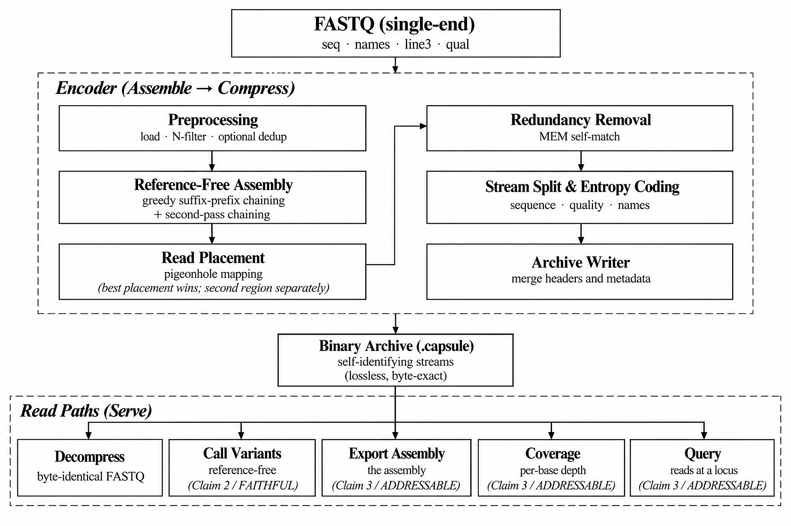

# Technical architecture

This document describes how G_CAPSUL works from the first byte read to the last byte written, and
how each operation uses the archive afterwards. It follows the source, so every statement can be
checked against the file named beside it. It is independent of any single claim. The measured
results are in [`numbers_and_verification_index.md`](numbers_and_verification_index.md), and the
reasoning behind the design is in [`central_insight_and_mechanism.md`](central_insight_and_mechanism.md).

## 1. Source map

| File | Lines | Role |
|---|---:|---|
| `src/encoder.cpp` | 4,989 | The encoder `best106`: scope check, load, chaining, mapping, MEM self-match, stream building, coding, archive writing |
| `src/decoder.cpp` | 2,539 | The decoder `capsule_decode`: container walk, pseudogenome and read reconstruction, and the modes `export`, `coverage`, `query`, `index`, `call` |
| `include/seqpar_core.h` | 324 | Context-mixing DNA coder for the pseudogenome literal, shared by encoder and decoder |
| `include/coders_inproc.h` | 938 | Stream framing, the per-stream coder selector, the mismatch and reference coders |
| `include/coders_entropy.h` | 240 | PPMd7, FSE/Huff0 and range-coder wrappers used by the selector |
| `include/names_coder.h` | 971 | Read-name tokenizer and coder |
| `include/quality_coder.h` | 544 | Quality coder, wrapping the vendored fqzcomp |
| `include/caps_pack.h` | 118 | Read and quality packing shared by the encoder and the decoder for the variant caller |
| `include/caps_fmi.h` | 531 | FM-index over the reads that differ from the pseudogenome |
| `include/caps_caller.h` | 5,970 | The reference-free variant caller |
| `scripts/build_scripts/encode_adaptive.sh` | | Driver that selects the candidate parameters and calls the encoder |

Encoder and decoder share the coder headers, so a model cannot drift between the two sides. The
same applies to `caps_pack.h`, which is used by both sources of caller input.

## 2. Overview



Figure 1 of the manuscript shows the workflow. Its boxes correspond to the code as follows.

| Figure 1 box | What it covers | Section |
|---|---|---|
| Preprocessing: load, N-filter, optional dedup | Scope check, load, N substitution, duplicate collapse, prefix containment | 3.1, 3.2 |
| Reference-free assembly | Seed index, round-1 classification, round-2 chaining, chain emission | 3.3 |
| Read placement | Pigeonhole mapping, best placement wins, second region | 3.4, 3.5 |
| Redundancy removal: MEM self-match | Maximal exact matches inside the pseudogenome | 3.7 |
| Stream split and entropy coding | Placement, deviation, N, order, name and quality streams, each coded separately | 3.6, 3.8, 3.9 |
| Archive writer | Header and self-identifying streams | 4 |
| Decompress | Pseudogenome rebuild, read reconstruction, name and quality decoding | 5 |
| Call variants | Reconciled substrate, pileup, graph and indel channels | 7 |
| Export assembly, coverage, query | Served from the placement and pseudogenome streams | 6 |

## 3. The encoder

### 3.1 Scope check and load

Before any work, the encoder reads the whole input and refuses unsupported input with a `FATAL:`
message (`src/encoder.cpp`, scope-check block after `main`). The accepted input is listed in
[`PROJECT_SCOPE.md`](PROJECT_SCOPE.md).

Reads are packed at two bits per base into 64-bit words, 32 bases per word, and every read starts
on a word boundary. A read containing `N` cannot be packed in two bits, so each `N` is replaced by
`A` and the read goes through the same pipeline as every other read. The original index of the
read, the number of `N` and their offsets go to three small side streams (`n_indices`, `n_cnt`,
`n_pos`), and the decoder puts the `N` back at the end. This avoids a separate pseudogenome for
ambiguous reads. An offset is stored in one byte, which is why a read longer than 256 bases may not
have an `N` after base 256.

### 3.2 Duplicates and prefix containment

**Exact duplicates.** Each read is hashed with FNV-1a and compared on a hash hit. A repeated read is
not stored again. The map from original reads to unique reads is kept (`orig2uid`). When the
duplicate fraction is below 0.15 the collapse is skipped and duplicates are handled by chaining
instead (`NODEDUP` overrides this).

**Prefix containment.** Quality trimming makes some reads strict prefixes of others. Such a read
carries nothing its container does not, so it leaves the read set and its originals point to the
container. The pass applies only when read lengths vary, because at constant length containment can
only mean equality. The reads are sorted lexicographically, so a prefix sits next to its extensions
and one linear scan finds every containment, and chains of containers are followed to the end. The
true length of every original read is stored separately (`read_lengths` is per original read), so a
contained read decodes at its own length.

### 3.3 Overlap chaining

Chaining builds the pseudogenome by joining reads whose suffix equals another read's prefix over at
least `MINOV` bases. Two properties make it fast and exact.

- **One seed per read.** A 32-base seed packs exactly into a `uint64` at two bits per base, so seed
  comparison is integer equality with no false positives. Sliding the seed by one base is a shift
  and an OR. The prefix index is a sorted array of `(seed, read id)` words plus an open-addressing
  table that points at each key's first entry, and a candidate is rejected cheaply using the eight
  bases after the seed before the full overlap is verified.
- **True descending sweep.** Every still-open read end is revisited at every overlap length, longest
  first. A read whose best partner is already taken still gets its next-best partner one length
  down. Storing one best partner per read instead leaves many reads unlinked, and every unlinked
  read starts a chain that costs a full read length.

Chaining runs in two rounds.

1. **Round 1 classifies.** It builds nothing. It finds which reads have a neighbour on both sides.
   Those reads tile the genome well. Reads at chain ends or unlinked overlap poorly, and they cost
   less when mapped into the finished sequence than when assembled into it.
2. **Round 2 builds** from the well-overlapped reads, with the overlap floor `MINOV`.

Chains are then written into the pseudogenome end to end, and each chain's start and end are kept as
a contig span (needed later by the variant caller, see 7.1). Reads that did not take part in a chain
are held back for mapping.

### 3.4 Pigeonhole mapping

Each held-back read is placed on the pseudogenome built so far, forward and against the reverse
complement. The pigeonhole principle drives the search: a read with at most `m` mismatches, cut into
`m + 1` parts, has at least one part that matches exactly. Seeds are taken from each read at a fixed
stride and indexed in one packed array. A seed only proposes a placement. Acceptance is a separate
test, a mismatch count computed with XOR and popcount on the two-bit words. A read keeps its
fewest-mismatch placement, so a better hit replaces an earlier one.

**Mapping ceiling `MAXMAP`.** A read is accepted up to `MAXMAP` mismatches. The ceiling is a ratio of
the longest read length (`Lmax / 13`, at least 6) because each stored mismatch costs about 0.88
bytes against about 0.229 bytes for a pseudogenome base, which puts the break-even near 0.26 of the
read length. The ceiling rises with the fraction of reads left over after chaining. The ramp starts
at a leftover fraction of 0.60 and reaches `Lmax / 5` at 0.85. Every benchmark dataset lies below
0.60, so the ramp does not change their output. It engages for low-coverage data.

### 3.5 Second region

Reads that could not be mapped are not stored raw. They are chained by their own instance of the
two-round procedure, producing a second pseudogenome region after the end of the main one. The
boundary (`main_pg_end`) is stored in the archive header. Positions of second-region reads are
coded separately from main-region ones (`pos_sec`, `pos_region`).

### 3.6 Placement, order and length streams

The archive must restore each read's sequence, its strand, its length and its place in the original
file. Positions are stored once per unique read, not once per original read, because duplicates
would repeat the value. The streams are:

| Stream | Holds |
|---|---|
| `pos_abs` | Start of each main-region unique read, as a fixed 32-bit integer. For a reverse-strand read the stored value is `main_pg_end − start − length`. |
| `pos_sec`, `pos_region` | Second-region positions as zigzag varint deltas, and a bitmap marking which reads are in the second region. |
| `pos_strand` | One bit per unique read, set for the reverse strand. |
| `read_lengths` | One length per **original** read, so contained reads keep their own length. |
| `orig2uid_flags`, `orig2uid_vals` | The map from original reads to unique reads. A read that is simply the next new unique read needs no value. Only a duplicate stores a back-reference. |

There is no separate permutation of read order. The order of the original reads is carried by
`orig2uid`, because unique reads are numbered in first-occurrence order. An earlier design that
stored a permutation was dropped, since a random permutation of `n` reads costs about `log2(n!)`
bits and the order here is far from random. Fixed-width 32-bit positions were also kept over varints
because their byte alignment suits the LZ coders (7.9% smaller on E. coli).

### 3.7 MEM self-match

After both regions exist, a maximal-exact-match pass finds repeated stretches anywhere in the
pseudogenome, forward and reverse complement, within the main region, within the second region and
across them. A match of at least `MINMEM` bases becomes a reference `(destination, source, length,
strand)`, and the bases it covers leave the `literal` stream.

- **Exact sampling.** The source is sampled every `STEP = MINMEM − seed + 1` positions. A match of at
  least `MINMEM` bases spans enough consecutive seed starts to contain a multiple of `STEP`, so no
  qualifying match is missed.
- **Candidate walk.** Up to `MAXCAND` candidates are examined at each position and the longest is
  kept. Lazy matching is on by default.
- **Cost-aware acceptance.** A match costs about 40.5 bits (source, gap and length) and saves about
  1.92 bits per base, so it pays when it is longer than about 21 bases.
- **Non-overlapping partition.** Matches are sorted by destination and trimmed against territory
  already claimed, so the literal and the references describe one non-overlapping partition of the
  pseudogenome. The decoder depends on this.
- **Extension mismatches.** A match may continue past a differing base, up to four times, and store
  the offset of each difference. The observed base is not stored separately, because it already sits
  in the pseudogenome at that offset. This is switched on by a heterozygosity pre-scan. The encoder
  samples a canonical 31-mer from every 41st position of the main region. If at least 2.4% of the
  distinct sampled k-mers occur exactly twice, the sample looks diploid and the tolerance is set to
  2. A haploid sample leaves it at 0. The threshold lies between the values measured on three haploid
  datasets (0.0103, 0.0172, 0.0209) and on the one heterozygous human dataset used for calibration
  (0.0264), so it is a heuristic calibrated on few datasets. `MEM_MAXMM_OVERRIDE` sets the tolerance directly.
  Deriving it from the leftover fraction instead, for low-coverage data, was built and tested on a
  2.6× coverage dataset. It cost 490,763 bytes more than it saved and is not used.

The decoder replays these references in order and applies each extension mismatch immediately,
because a later reference can copy from a position an earlier reference has just corrected.

### 3.8 Deviations and N streams

A mapped read differs from the pseudogenome at a few positions. Reconstruction needs only where and
what.

| Stream | Holds |
|---|---|
| `mm_cnt` | Number of deviations per unique read. Replaced by `mm_cnt_flags` and `mm_cnt_vals` when a flag bitmap plus values is smaller. |
| `mm_pos` | Offsets from the previous deviation in the same read, in one byte when the longest read is at most 256 bases and otherwise as a varint. Coded flat or bucketed by the read's deviation count. |
| `mm_sym` | The observed base, coded given the base it replaced. That reference base is not stored, because the decoder derives it from the pseudogenome. |

The decoder therefore rebuilds the pseudogenome first, derives every reference base in the encoder's
own order and then decodes the observed bases.

### 3.9 Stream coding

Every stream is built in memory (`open_memstream`) and nothing is written to disk. Each is coded by
a coder chosen for it, and its raw buffer is freed as soon as it has been coded, so peak memory
follows the largest live stream and not their sum.

| Content | Coder |
|---|---|
| `literal` (the pseudogenome bases no reference covers) | Context-mixing coder in `seqpar_core.h`. Ten order-`k` models over the previous 1, 2, 3, 4, 6, 8, 11, 14, 18 and 22 bases, a match model on the last 24 bases, a logistic mixer and an APM stage, and a binary arithmetic coder. The stream is split into four chunks coded in parallel. Four was chosen because it is within 2.5 KB of a single chunk on E. coli while remaining parallel. |
| `mem_triples` | Source positions, range coded within a bound derived from each destination (`refc`). |
| `mm_sym` | The mismatch symbol coder (`mmc`). |
| `names_*` | A tokenizer that codes each token against the token in the same position of the previous header (`nmc`). Blocks of 250,000 names are coded on a thread pool. |
| `qual_*` | fqzcomp from htscodecs, in blocks. |
| Everything else | The per-stream selector `best_encode`. |

**The selector.** `best_encode` tries xz, xz with `lc/lp/pb = 2/2/2`, PPMd7 (order 5, 32 MB), FSE
with Huff0, a range coder with per-position models, and for 32-bit streams two byte-plane variants. On
a large stream it picks by coding a probe of 40% of the data. It stores the choice in one method byte
followed by the raw length, so the decoder needs no other information. A stream above 4 MB is split
into independent chunks coded in parallel (method 7), and a constant stream is stored as a single
marker.

**Names and quality overlap the assembly.** They depend only on the input file, not on the assembly,
so they run in a separate thread from the start and are joined before the parameter-search fork.

### 3.10 Parameter search and process model

`scripts/build_scripts/encode_adaptive.sh` calls the encoder with a set of candidate parameter
pairs `(MAXMAP, MINOV)` and keeps the smallest archive. The default grid has two candidates, with
`MAXMAP = Lmax / 5` and `MINOV` either 16 or `0.35 × Lmax`. `GRID4=1` adds `Lmax / 13` and `GRID8=1`
adds two further ceilings. The script passes `3 16 16 22 16 16 1 24 64 1` as positional arguments, which
sets a 16-base chaining and mapping seed, a mapping seed stride of 22 and `MINMEM = 24` (see
[`configuration_reference.md`](configuration_reference.md) for the other defaults compiled into the
encoder).

| Grid | Compared with | Mean archive size | Worst dataset |
|---|---|---:|---|
| 4 points | the 8-point grid | +0.031% | +0.357% (A. fumigatus) |
| 1 fixed point | the 8-point grid | +0.41% | +0.782% |
| 2 points (shipped) | the 4-point grid | +0.032% | +0.444% (H. salinarum) |

These figures come from 14 datasets of 8.7 to 574 MB. The `MINOV` dimension cannot be dropped,
because each value is best on some datasets and removing the worse costs up to 0.629%.

The candidates are not run as separate encodes. The work before the candidates differ (load, seed
index, round 1) is identical, so the encoder forks one child per distinct `MINOV` after round 1.
Each child runs round 2, chain emission and the mapping search once, then forks one grandchild per
`MAXMAP`. Mapping always keeps the minimum-mismatch placement, so running it once at the group's
ceiling gives every member its answer. `fork()` gives each candidate an exact copy of the shared
state, so the code path is the one a single run would take. How many candidates run at once is
derived from free memory, and the output is the same for any number: every candidate is always
evaluated. Re-encoding E. coli on 2, 3, 7 and 12 cores produced identical archives.

## 4. The archive

An archive is a header followed by named streams. All integers are little-endian.

```
"CAPSULE\0"  8 B    magic
version      u16    2
pg_len       u64    pseudogenome length in bases
main_end     u64    boundary between the main and second regions
minmem       u32    minimum MEM length
n_streams    u16
n_streams x  [name_len u8][name][coded_len u64][payload]
payload      [method u8][raw_len u64][coded bytes]
```

The header is 32 bytes, and the names and lengths of the streams add about 300 bytes in total.
`minmem` is stored because the reference-length stream holds length minus `minmem` and the gaps are
measured from the end of the previous match, so neither can be decoded without it. The decoder finds
streams by name, so a new stream is additive and an older archive still decodes.

An archive holds up to 29 streams.

| Group | Streams |
|---|---|
| Pseudogenome | `literal`, `mem_triples`, `mem_dstgap`, `mem_len`, `mem_rc`, `mem_self` (second-region self matches, absent when none), `mem_extmm_cnt`, `mem_extmm_pos`, `mem_extmm_obs` (extension mismatches, absent when none), `contig_spans` (with `CAPS_SPANS=1`) |
| Placement | `pos_abs`, `pos_sec`, `pos_region`, `pos_strand` |
| Deviations | `mm_sym`, `mm_pos`, `mm_cnt` or `mm_cnt_flags` with `mm_cnt_vals` |
| Reads with N | `n_indices`, `n_cnt`, `n_pos` |
| Original reads | `read_lengths`, `orig2uid_flags`, `orig2uid_vals` |
| Optional columns | `names_body`, `names_dict`, `names_index` (`CAPS_NAMES=1`), `qual_body`, `qual_index` (`CAPS_QUAL=1`) |

`contig_spans` is the one thing the decoder cannot recompute. The chain boundaries come from the
assembly and the decoder only sees the rebuilt sequence. They are stored as the span count followed
by the gap and the length of each span, and they cost almost nothing because spans are nearly
contiguous (0 bytes on the E. coli measurement).

A usable archive requires `DUMP_PERM=1` and `DUMP_MM=1`. They gate the code that fills the
placement, length, order and deviation streams. Without them the streams are silently missing and
the archive decodes to nothing. The names are historical, and `encode_adaptive.sh` sets them.

## 5. Decoding

`capsule_decode` reads every stream into a map keyed by name and decodes the ones a mode needs.

1. **Pseudogenome.** The `literal` stream is decoded to bases. The references are then replayed in
   destination order. Gaps between references are filled from the literal, a reference copies from
   earlier output, and a reverse-complement reference copies the complement backwards. Each extension
   mismatch is applied at once, using the same adaptive model as the encoder, one symbol at a time.
   The stream must be fully consumed or the decode stops with an error.
2. **Reads.** Reads are reconstructed in parallel in blocks of 4,096. For read `o`, the unique read
   `u = orig2uid[o]` gives the placement and strand. A forward read copies the pseudogenome from
   its position. A reverse read copies the complement of the pseudogenome backwards, using the
   length of the unique read so that a contained read, which is a suffix in pseudogenome space,
   is read from the right end. The deviations of `u` are then applied. Each offset is a delta from
   the previous one, and for a reverse read the observed base is complemented.
3. **N bases.** The positions recorded in `n_indices`, `n_cnt` and `n_pos` are set back to `N`.
4. **Names and quality.** These are decoded block by block from their own streams. Quality decoding
   starts in a separate thread as soon as the read lengths are known, and names stream to the
   output file so memory stays bounded.

The decoder writes the sequences, the names and the quality as separate files. The FASTQ is formed by
interleaving them, with line 3 either a bare `+` or `+` followed by the name, as stored. The
archive itself is what verification decodes. Decoding the encoder's raw intermediate streams
instead would skip the entropy coders and could not detect a fault in them.

## 6. Operations served from the archive

Each mode stops as soon as it has the streams it needs.

| Mode | Streams decoded | What it computes |
|---|---|---|
| `coverage` | `pos_abs`, `read_lengths`, `orig2uid`, and the header | Per-base depth from placements and lengths. It never decodes the literal or the references, because depth does not depend on the pseudogenome content. When reads share a unique placement their multiplicity is counted. |
| `export` | `literal`, the references | The pseudogenome as FASTA. By default two records are written, the main region and the second region. With `CAPSULE_EXPORT_CONTIGS=1` and `contig_spans` in the archive, one record is written per contig. |
| `query` | placements, pseudogenome | Reads that overlap a pseudogenome range, or that contain a DNA sequence. |
| `index` | everything the sidecar needs | The optional sidecar files described below. |
| `call` | placements, `contig_spans`, reads | Variant calls, see section 7. |

### 6.1 The sidecar

`index` decodes the archive once and writes files beside it. The archive is not changed and its size
is not affected.

| File | Content | Built with |
|---|---|---|
| `<out>` | The decoded sidecar: the pseudogenome at 2 bits per base, then 6 bytes per unique read (placement and length), and with pileup the deviations, strand bitmap and N positions | always |
| `<out>.sites` | An allele-resolved tally of the deviations by pseudogenome position | `CAPS_PILEUP=1` |
| `<out>.fmi` | The FM-index over the reads the pseudogenome cannot represent | `CAPS_FMI=1` |
| `<out>.xmi` | An older k-mer index over the same reads, kept for comparison | `CAPS_XMI=1` |

On the four GIAB chromosome 20 windows the decoded sidecar was 3.0 to 3.4 times the archive.

### 6.2 Query

**By position.** Reads whose placement overlaps the range `START-END` are returned.

**By sequence.** A probe is searched in the pseudogenome. For a tolerance `k`, the probe is cut into
`k + 1` seeds, and the pigeonhole principle guarantees that some seed matches exactly. Every
candidate is verified against the full tolerance. The shortest usable seed is `ceil(log4 |pg|) − 2`,
clamped to 8 to 16, because a seed of length `L` occurs by chance about `|pg| / 4^L` times, so
specificity is a property of the sequence being searched.

**By locus.** A site is probed through its flanking sequence on both sides with the variant base
excluded, and the two retrieved read sets are combined. This reaches reads that were placed on a
disconnected pseudogenome region, which a single stored coordinate would miss.

**Complete exact match.** A read with no deviation and no `N` is emitted exactly as its pseudogenome
stretch, so any string it contains is found by searching the pseudogenome. Only reads that carry
deviations or `N` can be missed. Compression already separates these two groups, so the FM-index
covers only the second group. Together the two searches return every read containing the probe,
with no tolerance and no minimum probe length. The index is a Burrows–Wheeler transform of the
reads joined by `#`, built with SA-IS in linear time, with 2 bits per row for the four bases, rank
checkpoints every 512 rows, and no suffix-array samples because a read is located by walking back
to its start. Reads the archive restores but `query` cannot emit as themselves are stored verbatim
in the same file.

## 7. The variant caller

The caller (`include/caps_caller.h`) works on the reads of an archive with no reference genome.
`capsule_decode call` builds its input from an archive that holds `contig_spans`.

### 7.1 Input

The caller needs each read's contig, offset in the contig, strand and left clip. Chains are captured
as contigs during assembly, before the MEM stage runs, because the MEM stage changes which bases are
coded as literal and never the pseudogenome. A mapped read lands inside an existing span, so it
inherits that contig. Without the spans one long pseudogenome would erase the separation between
haplotype contigs that the indel search needs.

### 7.2 Pipeline

| Step | What it does |
|---|---|
| Substrate | Contigs that are near-duplicates of a longer contig are dropped (`collapse_contigs`), then reads are placed again on the surviving contigs. The duplication fraction is 0.45 for SNV analysis and 0.92 for indel analysis. |
| k-mer counts | Canonical 31-mer counts over all reads, spilling to disk above a memory ceiling. The haploid depth is estimated from their abundance distribution. |
| Pileup and SNV candidates | A per-contig pileup, candidate SNVs, a flank pass and filters. An alternate allele needs the larger of two reads or one tenth of the estimated haploid depth, and bases below Phred 20 are ignored. |
| Graph channel | A de Bruijn bubble search over the k-mers of the reads, run on diploid-looking samples. |
| Indel channels | Contig-pair bubble scan with anchors and junction support, positional clustering, a link scan and cross-contig SNVs. |
| Output | Sorted VCF in the coordinates of the contigs. |

The graph-only mode (`capsule_decode call` without `CAPS_CALL_INDELS`) skips the pileup, the second
substrate and the indel search and calls SNVs only. `CAPS_CALL_INDELS=1` runs the full caller, and
this is the mode behind every reported variant-calling number. The frozen parameters (`HDMAX=2`,
`MAF=0.20`, `DHI=2.5`, `KHI=1.1`, `MC=3`, `TRI=0.12`, `HALF=15`) are described at the point where
they are used in the source.

The SNV substrate and the indel substrate differ on purpose. A strong collapse (0.45) puts both
alleles of a heterozygous site onto one contig so that a pileup can count them. A mild collapse
(0.92) keeps the alternative haplotype contig, which is the structure a bubble needs. This is the
reconciliation described in [`central_insight_and_mechanism.md`](central_insight_and_mechanism.md).

## 8. Parallelism and memory

| Part | Behaviour |
|---|---|
| Scope check, load, containment | Serial |
| Chaining | Partly parallel |
| Mapping and MEM search | Threaded |
| Candidates | Forked processes, each mostly serial, so about 83% of a candidate's work does not scale with cores |
| Stream coding | A pool of coder jobs, plus chunked coding inside the large streams |
| Names and quality | A thread that overlaps the assembly |
| Pseudogenome rebuild | Serial, because each reference may read output of an earlier one |
| Read reconstruction | Parallel |
| Quality decoding | A thread that overlaps sequence decoding |

The encoder sets one malloc arena (`M_ARENA_MAX=1`), which removed a measurable amount of resident
memory at large scale by stopping per-thread arenas from holding freed memory. Reads are held
packed, and the read store and the indexes are released before the MEM stage allocates its own
index. Because candidates are separate processes, a measurement of peak memory by `/usr/bin/time` is
the peak of the largest single process.

## 9. Design decisions with their evidence

| Decision | Alternative tested | Result |
|---|---|---|
| Exact overlap chaining with a 64-bit seed | A hash index rebuilt for each overlap length | The first is O(n × offsets tried), and the second was O(n × L²). |
| Sweep starts at the full read length | Start one base below | Exact duplicates chain for free. On S. acidocaldarius (9.4% duplicates) the pseudogenome fell from 9,134,100 to 6,157,270 bytes. |
| Round 1 classifies and round 2 builds | Build in a single round | End-of-chain reads cost less mapped than assembled. |
| `MAXMAP = Lmax / 13`, raised only at low coverage | A fixed value | The best fixed value differs by dataset (E. coli 20, P. aeruginosa 27), and a fixed 20 lost 1.2% on P. falciparum. |
| Best placement wins | First acceptable placement | First-acceptable stored about 10.7 mismatches per placed read against 1.4, and each stored mismatch costs bits. |
| One `literal` coder in four chunks | One chunk or twelve | 1,804,223 bytes at four, 1,801,710 at one, 1,809,073 at twelve on E. coli. |
| Positions as fixed 32-bit integers | Varints | 7.9% smaller on E. coli and 11.1% on P. aeruginosa. |
| Positions per unique read | A stored read-order permutation | The permutation costs about `log2(n!)` bits, and the order is not random. |
| Names and quality coded once, before the fork | Inside each candidate | Quality was 68% of a candidate's time. |
| Exact MEM sampling | Sparse sampling that can miss matches | No qualifying match is missed. |
| Extension mismatches only for heterozygous samples | On for every sample | They add reference cost without benefit on a haploid sample. |
| Vendored fqzcomp for quality | An in-house quality coder | The in-house coder lost to fqzcomp by 1.1 to 4.5% on 8 of 8 datasets. |

Engineering notes with the full measurements are in
[`extras/ENGINEERING_NOTES_ENCODER.md`](extras/ENGINEERING_NOTES_ENCODER.md),
[`extras/ENGINEERING_NOTES_CODERS.md`](extras/ENGINEERING_NOTES_CODERS.md) and
[`extras/ENGINEERING_NOTES_CALLER.md`](extras/ENGINEERING_NOTES_CALLER.md).
